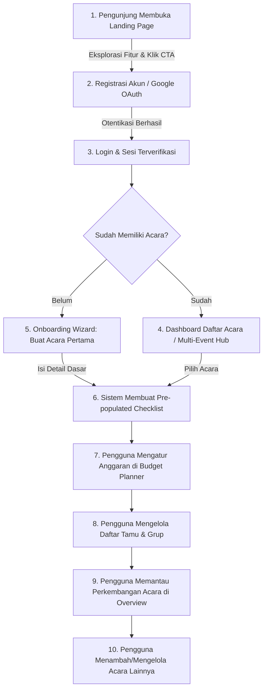

# MAZÉLIA — FUNCTIONAL REQUIREMENTS, USER JOURNEY & PAGE SPECIFICATIONS

**Dokumen Versi:** 1.0 — Final Specification  
**Status:** Ready for Development Review  
**Penulis:** Senior Business Analyst & Lead UI/UX Architect  
**Tanggal:** November 2026  

---

## 1. End-to-End User Journey (10 Tahapan Kunci)

Perjalanan pengguna dirancang mengalir alami, meminimalkan friksi input, dan memberikan kepuasan instan (*instant gratification*) sejak menit pertama pendaftaran:



### Rincian 10 Tahapan Perjalanan:
1. **Membuka Landing Page:** Pengunjung disuguhkan estetika editorial mewah, visual preview mockup planner, dan kalkulator estimasi anggaran instan yang memikat.
2. **Registrasi Akun:** Pengguna mendaftar dengan sekali klik menggunakan Google Sign-In atau formulir Email/Password yang ringkas.
3. **Login & Sinkronisasi Sesi:** Supabase SSR Auth memverifikasi sesi, membuat profil default di tabel `profiles`, dan mengarahkan pengguna secara cerdas.
4. **Masuk Dashboard Pertama Kali:** Sistem mendeteksi bahwa pengguna belum memiliki acara dan secara otomatis memunculkan dialog selamat datang (*Onboarding Modal*).
5. **Membuat Acara Pertama:** Pengguna memilih kategori acara (misal: Pernikahan), nama acara, tanggal, kota, dan target anggaran total dalam formulir 1 halaman yang bersih.
6. **Menerima Checklist Otomatis:** Begitu acara tersimpan, sistem secara otomatis menginjeksi 15–20 tugas standar lokal (misal: Booking KUA/Gereja, Pesan Gedung, Fitting Busana, dll.) ke dalam checklist acara tersebut.
7. **Mengatur Anggaran (Budget Planner):** Pengguna melihat alokasi anggaran, menambahkan rincian vendor, mencatat uang muka (DP), dan memantau status surplus/defisit secara real-time.
8. **Mengelola Daftar Tamu (Guest Management):** Pengguna menginput nama keluarga/sahabat, menetapkan kuota pax, mengelompokkan kategori tamu, dan men-generate teks undangan WhatsApp sopan.
9. **Memantau Perkembangan di Overview:** Pengguna memantau widget countdown hari-H, rasio penyelesaian tugas (X dari Y tugas selesai), dan meter penyerapan anggaran.
10. **Mengelola Beberapa Acara (Multi-Event):** Pengguna yang memiliki beberapa acara (misal: Lamaran di Juli dan Resepsi di Desember) dapat beralih konteks dengan mudah via menu navigasi tanpa ada data yang tertukar.

---

## 2. Final Sitemap & Routing Structure

Sistem routing menggunakan **Next.js App Router** dengan pemisahan konteks yang tegas untuk menjamin isolasi data multi-event:

```
/ (Landing Page Publik)
├── /login (Halaman Masuk)
├── /register (Halaman Pendaftaran)
├── /forgot-password (Pemulihan Kata Sandi)
└── /dashboard (Area Privat Pengguna)
    ├── /dashboard/events (Daftar Seluruh Acara Milik Pengguna)
    └── /dashboard/events/[id]/ (Ruang Kerja Acara Tertentu)
        ├── /overview (Ringkasan Metrik Acara)
        ├── /checklist (Manajemen Tugas & Timeline)
        ├── /budget (Manajemen Anggaran & Biaya)
        ├── /guests (Manajemen Daftar Tamu & RSVP)
        └── /settings (Pengaturan Acara & Jadwal Sesi)
```

---

## 3. Spesifikasi Lengkap 7 Fitur Utama MVP

---

### FITUR 1: Landing Page & Public Website

- **Deskripsi Fitur:** Halaman depan publik MAZÉLIA yang berfungsi memperkenalkan nilai produk, membangun kredibilitas merek premium, mengedukasi alur perencanaan, dan menjadi saluran konversi pendaftaran pengguna baru.
- **User Story:** *Sebagai calon pengantin atau penyelenggara acara, saya ingin melihat manfaat dan tampilan MAZÉLIA di halaman depan agar saya yakin untuk mendaftar dan mengelola acara saya di platform ini.*
- **Functional Requirements:**
  1. Menampilkan Header elegan dengan logo MAZÉLIA, navigasi menu (*Fitur, Keunggulan, Testimoni*), tombol "Masuk", dan CTA "Mulai Gratis".
  2. Hero Section dengan tipografi editorial (*serif heading*), tagline *Events • Moments • Memories*, dan gambar mockup dashboard responsif.
  3. Interactive Mini-Calculator: Pengunjung dapat memilih kategori acara dan menggeser estimasi tamu untuk melihat rekomendasi pembagian anggaran kasar tanpa harus login.
  4. Feature Grid: Showcase modul Checklist, Budget Planner, Guest Management, dan Digital Invitation (Coming Soon).
  5. Footer memuat informasi hak cipta, navigasi kebijakan privasi (*Privacy Policy*), syarat penggunaan, dan kontak bantuan.
- **Input Fields:** Dropdown Kategori Acara dan Slider Estimasi Jumlah Tamu (pada widget simulasi interaktif).
- **Business Rules:**
  - Halaman harus di-render secara *Server-Side Rendered (SSR)* atau statis dengan OpenGraph metadata lengkap untuk kebutuhan SEO dan pratinjau link media sosial yang indah.
- **Validation Rules:** Slider simulasi tamu bernilai minimal 50 pax dan maksimal 2.000 pax.
- **Success State:** Halaman termuat dalam waktu < 1.5 detik dengan visual editorial yang tajam dan transisi halus.
- **Error State:** Tampilan fallback jika browser pengguna mematikan Javascript atau koneksi internet lambat.
- **Empty State:** N/A (Halaman publik berorientasi konten).
- **Acceptance Criteria:**
  - Lolos uji responsivitas di resolusi mobile (360px - 430px), tablet (768px), dan desktop (1280px+).
  - Skor Google Lighthouse Performance $\ge 90$ dan Accessibility $\ge 95$.

---

### FITUR 2: Authentication & User Profile

- **Deskripsi Fitur:** Modul otentikasi aman berbasis Supabase Auth yang mendukung login via Email/Password dan Google OAuth, dilengkapi pengelolaan data profil pengguna.
- **User Story:** *Sebagai pengguna baru, saya ingin dapat mendaftar dengan akun Google atau Email saya secara cepat dan aman agar saya dapat segera mulai merencanakan acara.*
- **Functional Requirements:**
  1. Registrasi via Email & Kata Sandi dengan verifikasi email otomatis.
  2. Single Sign-On (SSO) via Google OAuth.
  3. Login dan pemulihan kata sandi (*Forgot/Reset Password*).
  4. Manajemen sesi menggunakan cookie `httpOnly` yang aman via `@supabase/ssr`.
  5. Halaman edit profil pengguna (Nama Lengkap, Nomor WhatsApp dengan format Indonesia, dan unggah foto avatar).
- **Input Fields:**
  - Email (string, email format).
  - Password (string, minimal 8 karakter).
  - Nama Lengkap (string, 3–150 karakter).
  - Nomor WhatsApp (string, format +628... atau 08...).
  - Foto Avatar (file image, max 2MB, JPG/PNG/WebP).
- **Business Rules:**
  - Registrasi via Google otomatis membuat record di tabel `public.profiles` dengan mengambil nama dan foto dari akun Google pengguna.
  - Sesi otomatis diperbarui di latar belakang tanpa me-logout pengguna secara tiba-tiba (*silent token refresh*).
- **Validation Rules:**
  - Password wajib memiliki minimal 1 huruf besar, 1 huruf kecil, dan 1 angka.
  - Format nomor WhatsApp divalidasi ke format standar internasional E.164 (`+628xxxxxxxxxx`).
- **Success State:** Notifikasi toast sukses dan pengalihan instan ke `/dashboard/events`.
- **Error State:** Pesan kesalahan deskriptif dalam Bahasa Indonesia (contoh: *"Email atau kata sandi tidak sesuai"*, *"Format nomor WhatsApp tidak valid"*).
- **Empty State:** Foto avatar default menggunakan inisial nama elegan di atas latar belakang Champagne Gold jika pengguna belum mengunggah foto.
- **Acceptance Criteria:** Pengguna dapat mendaftar, login, refresh halaman tanpa kehilangan sesi, dan keluar (*logout*) dengan aman.

---

### FITUR 3: Event Management Hub

- **Deskripsi Fitur:** Jantung pengelolaan acara yang memungkinkan pengguna membuat beberapa acara sekaligus, memilih kategori, mendefinisikan jadwal sesi (Akad & Resepsi), kota, target anggaran, dan beralih antar acara.
- **User Story:** *Sebagai penyelenggara acara, saya ingin membuat acara baru dan beralih antar acara dengan mudah agar persiapan setiap acara saya terpisah rapi.*
- **Functional Requirements:**
  1. Halaman `/dashboard/events` yang menampilkan daftar kartu seluruh acara milik pengguna beserta ringkasan progresnya.
  2. Modal/Halaman pembuatan acara baru: Kategori Acara, Judul Acara, Tanggal Acara, Kota Penyelenggaraan, dan Total Target Anggaran.
  3. Pengaturan multi-sesi jadwal (Akad Nikah, Pemberkatan, Resepsi Malam) lengkap dengan nama venue dan alamat.
  4. Pemilih acara aktif (*Event Switcher Dropdown*) pada navigasi utama dashboard.
  5. Pengaturan acara (Ubah Judul, Ubah Tanggal, Arsipkan Acara, atau Hapus Acara).
- **Input Fields:**
  - Kategori Acara (Dropdown: Pernikahan, Lamaran, Ulang Tahun, Anniversary, Lainnya).
  - Judul Acara (string, 5–150 karakter, contoh: *"The Wedding of Dimas & Anissa"*).
  - Tanggal Acara (Date Picker).
  - Kota (string, dropdown/combobox kota-kota di Indonesia).
  - Target Anggaran (integer dalam Rupiah murni).
  - Sesi Acara: Nama Sesi, Waktu Mulai, Waktu Selesai, Nama Tempat, Alamat Lengkap.
- **Business Rules:**
  - Pembuatan acara baru secara otomatis mentrigger pembuatan template checklist bawaan kategori acara tersebut.
  - Menghapus acara (*Delete Event*) akan menghapus seluruh data checklist, budget, dan tamu terkait secara *cascade* setelah pengguna mengetikkan konfirmasi nama acara.
- **Validation Rules:**
  - Tanggal acara tidak boleh di masa lampau (minimal H+1 dari hari ini).
  - Target anggaran tidak boleh negatif (minimal Rp 0).
- **Success State:** Event tersimpan di tabel `events` dan pengguna langsung dialihkan ke `/dashboard/events/[id]/overview`.
- **Error State:** Menampilkan border merah pada input yang tidak valid dengan pesan bantuan konteks.
- **Empty State:** Jika pengguna belum memiliki acara di `/dashboard/events`, tampilkan ilustrasi elegan, teks ajakan hangat, dan tombol besar *"Buat Acara Pertama Anda"*.
- **Acceptance Criteria:** Pengguna dapat membuat minimal 3 acara berbeda dan data antar acara terbukti 100% terisolasi tanpa ada kebocoran ID.

---

### FITUR 4: Event Checklist & Timeline

- **Deskripsi Fitur:** Modul pelacak tugas berbasis lini masa yang terstruktur berdasarkan fase waktu persiapan acara, dilengkapi sistem centang selesai dan penambahan tugas mandiri.
- **User Story:** *Sebagai calon pengantin, saya ingin melihat daftar tugas apa saja yang harus diselesaikan dari 6 bulan sebelum hari-H hingga hari-H agar tidak ada persiapan penting yang terlewat.*
- **Functional Requirements:**
  1. Menampilkan daftar tugas yang dikelompokkan berdasarkan fase waktu:
     - *Fase 1: Persiapan Awal (H-6 s/d H-12 Bulan)*
     - *Fase 2: Pemilihan Vendor & Administrasi (H-3 s/d H-5 Bulan)*
     - *Fase 3: Detail Teknis & Undangan (H-1 s/d H-2 Bulan)*
     - *Fase 4: Finalisasi & Hari-H (H-1 Minggu s/d Hari-H)*
  2. Toggle centang (*checkbox*) untuk menandai tugas selesai atau belum, dengan pembaruan instan (*optimistic UI update*).
  3. Tombol "Tambah Tugas Kustom": Pengguna dapat memasukkan nama tugas, kategori, tenggat waktu, dan catatan tambahan.
  4. Filter tugas: "Semua Tugas", "Belum Selesai", "Sudah Selesai".
  5. Indikator progres persentase tugas selesai di bagian atas halaman.
- **Input Fields:**
  - Nama Tugas (string, 3–200 karakter).
  - Kategori Tugas (Dropdown: Venue, Katering, Busana, Dokumentasi, Legal/KUA, Lainnya).
  - Tanggal Tenggat / Due Date (Date Picker, opsional).
  - Catatan Khusus (textarea, opsional).
- **Business Rules:**
  - Saat event pertama kali dibuat, sistem mengisi minimal 15 tugas standar relevan dari tabel pustaka kategori.
  - Perubahan status tugas langsung memperbarui persentase progres di Overview Dashboard.
- **Validation Rules:** Nama tugas tidak boleh kosong atau hanya berupa spasi.
- **Success State:** Tugas langsung tercoret rapi saat dicentang dengan animasi mikro elegan; progres bar bertambah secara proporsional.
- **Error State:** Jika koneksi terputus saat mencentang tugas, status dikembalikan (*rollback*) dan muncul notifikasi *"Gagal menyimpan perubahan, periksa koneksi Anda"*.
- **Empty State:** Jika semua tugas pada filter telah selesai, tampilkan pesan apresiasi: *"Luar biasa! Semua tugas pada tahap ini telah selesai."*
- **Acceptance Criteria:** Dicentang atau ditambahkan tugas baru dapat tersimpan permanen di database tanpa perlu reload halaman web.

---

### FITUR 5: Budget Planner (Kalkulator Keuangan Acara)

- **Deskripsi Fitur:** Modul pencatatan dan kalkulasi finansial komprehensif berformat Rupiah murni untuk memastikan pengeluaran acara tetap terkendali dalam batas target anggaran.
- **User Story:** *Sebagai pemilik acara, saya ingin mencatat estimasi biaya setiap vendor, pembayaran uang muka (DP), dan sisa pelunasan agar saya tahu persis apakah anggaran saya surplus atau defisit.*
- **Functional Requirements:**
  1. Kartu Ringkasan Finansial:
     - **Target Anggaran Total:** Plafon biaya awal yang ditetapkan.
     - **Total Estimasi Biaya:** Akumulasi estimasi nilai seluruh vendor/pos biaya.
     - **Total Realisasi Biaya:** Akumulasi nilai kontrak/biaya riil yang disepakati.
     - **Total Dana Terbayar:** Jumlah uang tunai/DP yang sudah ditransfer.
     - **Sisa Dana / Status Defisit:** Indikator visual hijau (*Surplus*) atau merah (*Over-budget*).
  2. Tabel Rincian Pengeluaran berdasarkan kategori (Venue & Dekorasi, Katering, Busana & Rias, Foto & Video, Entertainment, Logistik & Lain-lain).
  3. Setiap baris item pengeluaran mencakup: Nama Item, Estimasi (Rp), Biaya Riil (Rp), Terbayar (Rp), dan Status Pelunasan (*Belum Bayar / DP / Lunas*).
  4. Modal Tambah / Ubah Item Anggaran.
  5. Fitur hapus item anggaran dengan dialog konfirmasi.
- **Input Fields:**
  - Kategori Pengeluaran (Dropdown).
  - Nama Item / Pos Biaya (string, contoh: *"Sewa Gedung Resepsi"*).
  - Estimasi Biaya (integer Rupiah, contoh: Rp 45.000.000).
  - Biaya Riil / Kontrak (integer Rupiah, contoh: Rp 42.500.000).
  - Nominal Terbayar / DP (integer Rupiah, contoh: Rp 15.000.000).
  - Status Pelunasan (Auto-calculated: Jika Terbayar = 0 -> *Unpaid*; Jika Terbayar < Biaya Riil -> *Partially Paid*; Jika Terbayar >= Biaya Riil -> *Paid*).
- **Business Rules:**
  - Seluruh nilai nominal di database disimpan dalam tipe data `BIGINT` (Rupiah bulat, tanpa floating point) untuk mencegah kesalahan pembulatan desimal.
  - Input field di antarmuka otomatis memformat angka dengan tanda titik ribuan saat pengguna mengetik (contoh: mengetik `50000000` otomatis tampil sebagai `50.000.000`).
- **Validation Rules:**
  - Nominal biaya riil dan terbayar tidak boleh bernilai negatif.
  - Nilai terbayar tidak boleh lebih besar dari 150% nilai biaya riil (pencegahan salah ketik kelebihan nol).
- **Success State:** Nilai ringkasan dan indikator progres meter anggaran langsung ter-update secara reaktif.
- **Error State:** Input bernilai non-numerik otomatis ditolak saat pengetikan.
- **Empty State:** Jika belum ada item anggaran, tampilkan banner panduan: *"Belum ada pos pengeluaran. Klik 'Tambah Pos Biaya' untuk mulai mengalokasikan anggaran Anda."*
- **Acceptance Criteria:** Seluruh penjumlahan kolom dan selisih anggaran akurat 100% terhadap perhitungan matematika dasar; tidak ada anomali floating-point.

---

### FITUR 6: Guest Management (Manajemen Tamu & RSVP)

- **Deskripsi Fitur:** Modul pencatatan daftar tamu undangan, pengelompokan segmen relasi, penetapan alokasi jumlah kursi/pax, dan generator pesan WhatsApp personal untuk mempermudah distribusi kabar gembira.
- **User Story:** *Sebagai penyelenggara acara, saya ingin mendata siapa saja yang diundang, mengelompokkan keluarga dan sahabat, serta memiliki cara mudah mengirim pesan undangan via WhatsApp.*
- **Functional Requirements:**
  1. Halaman tabel manajemen tamu dengan filter kelompok (*Keluarga Inti, Sahabat, Rekan Kerja, VIP*) dan filter status RSVP (*Semua, Menunggu, Hadir, Berhalangan*).
  2. Kartu Ringkasan Tamu: Total Undangan, Total Estimasi Pax (Kursi), Jumlah Terkonfirmasi Hadir, Jumlah Berhalangan.
  3. Modal Tambah Tamu (Single entry): Nama Tamu, Nomor WhatsApp, Kelompok Tamu, Alokasi Jumlah Pax (default: 1 atau 2 kursi), dan Catatan Khusus.
  4. Quick RSVP Status Switcher: Pemilik acara dapat mengubah status RSVP langsung dari tabel (Menunggu / Hadir / Berhalangan) saat tamu mengabari lewat telepon/chat.
  5. **Tombol "Kirim Pesan WhatsApp" (One-Click Generator):**
     - Mengklik tombol ini otomatis membuka aplikasi WhatsApp (Web/Mobile) ke nomor tamu dengan draf teks sopan yang sudah terisi nama tamu bersangkutan.
  6. Fitur Hapus Tamu dan Ubah Data Tamu.
- **Input Fields:**
  - Nama Tamu (string, 2–150 karakter, contoh: *"Bapak Ir. Bambang & Keluarga"*).
  - Nomor Telepon/WhatsApp (string, opsional, format nomor telepon Indonesia).
  - Kelompok Tamu (Dropdown / Tambah Kelompok Baru).
  - Alokasi Kursi/Pax (integer, 1 s/d 10).
  - Status RSVP (Dropdown: *Pending / Attending / Declined / Tentative*).
  - Catatan Tambahan (textarea, opsional, contoh: *"Meja VIP Depan"*).
- **Business Rules:**
  - Setiap tamu otomatis dibuatkan `slug` unik terenkripsi untuk kebutuhan integrasi personalisasi undangan digital di Fase 2.
  - Penambahan kelompok tamu baru tersimpan di tabel `guest_groups` spesifik untuk `event_id` tersebut.
- **Validation Rules:**
  - Nama tamu wajib diisi.
  - Alokasi pax minimal 1 dan maksimal 20 per undangan.
- **Success State:** Tamu baru langsung muncul pada baris teratas tabel dengan badge kelompok berwarna lembut yang serasi.
- **Error State:** Pesan validasi jika nomor telepon tidak sesuai format telekomunikasi yang berlaku.
- **Empty State:** Ilustrasi kosong dengan teks *"Belum ada tamu terdaftar. Masukkan daftar keluarga dan kerabat terdekat Anda."*
- **Acceptance Criteria:** Pengguna dapat mendata minimal 100 tamu tanpa lag antarmuka; tombol WhatsApp membuka tautan `api.whatsapp.com/send` yang valid dan terbaca sempurna.

---

### FITUR 7: User Dashboard Overview

- **Deskripsi Fitur:** Halaman utama ruang kerja acara yang mengonsolidasikan seluruh metrik terpenting dari modul Checklist, Budget, dan Guest ke dalam satu layar pandang eksekutif yang tenang dan elegan.
- **User Story:** *Sebagai pemilik acara yang sibuk, saya ingin melihat ringkasan lengkap kondisi persiapan acara saya dalam satu layar tanpa harus mengecek setiap menu satu per satu.*
- **Functional Requirements:**
  1. Header Acara: Menampilkan Judul Acara, Tanggal & Lokasi Acara, dan **Widget Countdown Hari-H** besar yang elegan (*Contoh: "142 Hari Menuju Momen Bahagia"*).
  2. Quick Stats Grid (4 Kartu Utama):
     - **Status Hari:** Jumlah hari tersisa menuju hari-H.
     - **Progres Checklist:** Lingkaran progres persentase tugas selesai (misal: *24/40 Tugas Selesai - 60%*).
     - **Kesehatan Anggaran:** Baris meter penyerapan anggaran (*Realisasi vs Target*), nominal sisa dana, dan status keuangan.
     - **Rekapitulasi Tamu:** Total undangan yang dibagikan dan total estimasi kehadiran pax katering.
  3. Section "Tugas Prioritas Mendatang" (Upcoming Tasks): Menampilkan 5 tugas terdekat yang belum selesai berdasarkan tanggal tenggat waktu.
  4. Section "Jadwal Sesi Acara": Ringkasan waktu dan lokasi Akad Nikah / Resepsi.
  5. Quick Action Floating Buttons: Tombol cepat *"Tambah Tugas"*, *"Catat Pengeluaran"*, dan *"Tambah Tamu"*.
- **Input Fields:** N/A (Halaman agregasi data dan aksi navigasi cepat).
- **Business Rules:**
  - Data di halaman Overview dihitung secara instan menggunakan query agregasi database yang efisien dan di-cache menggunakan React Server Components.
- **Success State:** Seluruh widget angka terisi konsisten sesuai data riil yang ada pada tabel checklist, budget, dan guest.
- **Error State:** Tampilan pesan bersahabat jika ada kegagalan agregasi database dengan tombol muat ulang (*Refresh Data*).
- **Empty State:** Jika acara baru saja dibuat, widget checklist dan budget menampilkan panduan langkah pertama (Onboarding Tour).
- **Acceptance Criteria:** Seluruh metrik matematis di kartu ringkasan identik dengan data pada halaman detail masing-masing modul.
